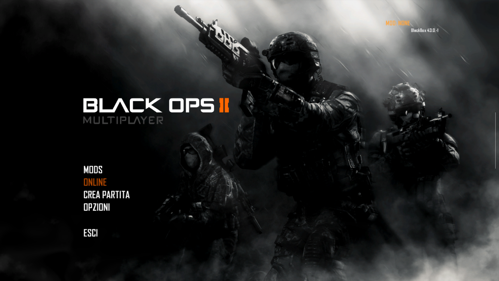
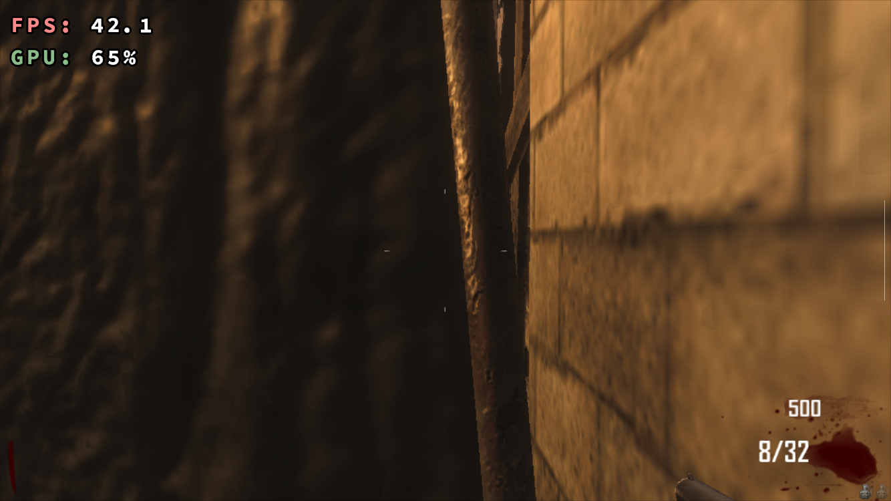

# dxvk-mali-android

A patched build of DXVK 1.9.2 so T6 Requiem (the Android port of Black Ops II) gets past the black
screen on Mali GPUs. I made it for my Retroid Pocket 4 Pro, which only showed a black screen with the
stock app.

It's a hobby thing. It works on the one device I have and that's about as far as my testing goes.

## Status

Works on my Retroid Pocket 4 Pro. Menus, a Zombies survival match and Multiplayer against bots all
run. Multiplayer is fine at 960x540 and a bit rough at 1280x720.

One device, one Android version, one driver version. I can't tell you how it behaves anywhere else,
and I'm not promising updates.




## Why the stock app doesn't work on Mali

The app comes with a few DXVK builds. The default one (2.6.0) needs Vulkan 1.3, and the Mali-G77 only
has 1.1.177, the log says so right away. There's also an old 1.9.2 build that only needs Vulkan 1.1,
but it asks the GPU for a few features the Mali-G77 doesn't have. It can't create a device and you get
a black screen anyway.

What the Mali-G77 on this device doesn't report: `textureCompressionBC`, `shaderClipDistance`,
`shaderCullDistance`, `fillModeNonSolid`, `multiViewport`, `geometryStreams`. It also lacks
`dualSrcBlend`, `multiDrawIndirect`, `logicOp` and `pipelineStatisticsQuery`, but those only matter at
higher D3D feature levels and the game works without them.

## What's in the build

The code is dxvk-native `native-1.9.2b` plus a patch. Short version of what the patch does:

| Thing | What I did |
|---|---|
| Window system | Added an SDL3 backend (the app ships SDL3, the fork only had SDL2) |
| ARM | Guarded the x86-only bits (SSE, `tzcnt` asm) |
| Missing features | Made them optional instead of required |
| Block compression | BC1-BC5 textures get decoded on the CPU when they're uploaded |
| Clip/cull distance, wireframe | Dropped from the shaders / drawn solid |
| Image views | Bad mip/layer ranges get rejected, the Mali driver crashes on them |
| Exceptions | Hidden symbol visibility, so exceptions don't cross between the two libraries |
| Gamma | The game leaves the last point of its gamma ramp unset, I patch it |
| Swap chain | `VK_SUBOPTIMAL_KHR` is not treated as an error anymore (see below) |
| Shaders | The "texture not bound" check is built at run time |

The last two matter most.

**Shaders.** DXVK wraps every texture sample in a select: bound texture gives the sample, otherwise
zero. The condition is a constant made of specialization constants. On this Mali driver that gets
evaluated wrong, the select always picks zero, and every texture sample returns black. Backgrounds were
black, text was invisible, and only things drawn without textures showed up. Building the condition
inside the function fixes it. This was the actual "invisible menu" bug and it took me way too long to
find.

**Swap chain.** Android returns `VK_SUBOPTIMAL_KHR` on every present because the screen is rotated
compared to the swap chain. DXVK treated that as a failure and recreated the swap chain every single
frame (1070 times in roughly a thousand frames). Now it only recreates on real errors. It didn't change the fps,
see limitations, but it was wasting around 5 ms per frame.

Full change list is in [the patch](patches/dxvk-native-1.9.2b-mali-android.patch).

## What it was built and tested on

Measured on my unit unless it says spec sheet.

| | |
|---|---|
| Device | Retroid Pocket 4 Pro |
| SoC | MediaTek Dimensity 1100 (MT8797Z/CZA, board mt6893) |
| CPU | 8 cores, 4 up to 2.6 GHz and 4 up to 2.0 GHz. Spec sheets say 4x Cortex-A78 + 4x Cortex-A55, I didn't check the core types |
| GPU | Mali-G77 MC9, driver 32.1.0 (r32p1), Vulkan 1.1.177, OpenGL ES 3.2 |
| RAM | 8 GB (8,075,912 kB in `/proc/meminfo`) |
| Storage | 128 GB (spec sheet) |
| Screen | 1334x750 landscape, 60 Hz, it's the only mode |
| OS | Android 13 (API 33), arm64-v8a |
| App | T6 Requiem 2.0.0 (versionCode 24) |
| Built with | Android NDK 27.0.12077973 (clang 18), meson 1.12.1, ninja, on Windows 11 |
| SDL3 headers | 3.2.0 (the app's libSDL3 reports a 3.5.0 dev build, nothing complained) |

## Devices

**Tested**

- Retroid Pocket 4 Pro. Only this one.

**Probably works, never tried**

- Other phones or handhelds with a Dimensity 1100 or 1200. Same GPU (Mali-G77 MC9) so same missing
  features. The driver version could be different, and I don't know if the shader bug is tied to the
  driver, so no promises.

**Maybe**

- Other Mali GPUs (G68, G57, G78 and so on). As far as I know none of them do BC textures and they're
  Vulkan 1.1 class too, but I haven't looked at their feature lists. The Retroid Pocket 4 (not the Pro)
  would be in here, I think it has a Dimensity 900 with a Mali-G68. Haven't checked.

**Doesn't need it**

- Snapdragon/Adreno devices. The stock app uses Turnip there. I haven't tried anything on those.

If you try it on something else, I'd like to know what happened: model, SoC, GPU, Android version,
Vulkan driver version, and the `dxvk-stderr.log` from the app's files folder.

## Install

You need T6 Requiem 2.0.0 and your own copy of the game, the app asks for the game folder. This repo
has no game files and no app.

The release is in [release/mali-release2](release/mali-release2). Check the zip against
`SHA256SUMS.txt`.

From what I can tell the app has a DXVK version option in Settings that imports a zip with
`libdxvk_dxgi.so` and `libdxvk_d3d11.so`. This zip has exactly those two files. **I did not use that
button with this zip.** What I did, and what I know works, is copy the files into the app's folder with
adb. That only works if the app is debuggable (mine was, `run-as` worked). Unzip the two libraries
first. I retyped the commands below from what my script did, so check the quoting for your shell:

```
adb push release/mali-release2/libdxvk_d3d11.so /data/local/tmp/
adb push release/mali-release2/libdxvk_dxgi.so /data/local/tmp/
adb push release/mali-release2/import.json /data/local/tmp/
adb shell "run-as com.volyre.bo2 sh -c 'mkdir -p files/dxvk_versions/mali-release2 && cp /data/local/tmp/libdxvk_d3d11.so /data/local/tmp/libdxvk_dxgi.so /data/local/tmp/import.json files/dxvk_versions/mali-release2/'"
adb shell "run-as com.volyre.bo2 sh -c 'printf mali-release2 > files/dxvk_version.cfg'"
```

`com.volyre.bo2` is the package name on my device. The app's
own logs say `com.t6requiem.bo2arm`, so yours may be different. After that it shows up in Settings as
"DXVK 1.9.2 (mali-release2)".

## Tips

- In Multiplayer, set Settings > Game resolution to 960 x 540. At 1280x720 I got around 20 fps with bots,
  at 960x540 about 42.
- Settings > DXVK HUD shows fps and GPU load on screen.
- With a controller connected the app hides the virtual controls ("Automatic"). The built-in pad on the
  Retroid counts as a controller.
- The first time something shows up (first shot, first explosion) the game stutters for a moment.
  See below, it gets better the more you play.
- If loading gets stuck on "Esperando el desafio..." just restart the game. Happened once in three
  starts, I don't know why.

## Limitations

Some of these I know for sure, some are guesses, I'll say which.

- **Tops out around 42 fps.** Menu, Zombies and Multiplayer all sit at 42.2-42.4, no matter if the scene
  has 16 or 2300 draw calls, and with the GPU at 17% or at 65%. It isn't the GPU, the display, vsync,
  DXVK's limiter, `com_maxfps` (tried 0), or the Vulkan side. The engine thread waits on another thread
  and the time per frame is a constant 23.56 ms. I think it's in the port's thread/event code but I
  never found it. Details in [docs/42-fps.md](docs/42-fps.md).
- **Stutter the first time an effect appears.** DXVK compiles the pipeline right then and the Mali
  driver is slow at it. I measured 120 to 134 compiles in a session, about 120 ms each on average,
  worst 467 ms. DXVK saves them in its state cache (per DXVK version in the app) so it gets smoother
  with every session.
- **No BC6H or BC7.** Only BC1 to BC5 are decoded. Those two formats would just not work. There are no
  "cannot create texture" errors in my logs, so the game doesn't seem to need them, but I can't be sure.
- **BC decoding is on the CPU.** In one session 64 uploads took more than 1.5 ms and the worst was
  15.6 ms. I didn't log the faster ones.
- **No user clip planes**, and wireframe draws solid. The game didn't seem to use either.
- **The other missing features aren't handled** (see top). Fine for this game, a different one could
  need them.
- **The shader fix may be driver specific.** I only have driver r32p1. A different Mali driver may not
  have the bug, or may have others.
- **The swap chain change is untested elsewhere.** It's right for a rotated display, but I only saw it
  on one screen.
- **Short tests.** About 3 minutes of Zombies per session and a 9 minute capture for Multiplayer (menus
  included). Nothing like a long session, I don't know about memory or heat over time.
- **One load hang** in three starts, see tips.
- **`libdxvk_dxgi.so` exports a few extra symbols** (SHA1 helpers) compared to the stock one. It didn't
  matter in my tests.
- **The game logs a lot of its own errors** (missing materials, `streaming_temp_image`, Demonware
  lobby, config files). I saw them on every run, with and without this build. Not related.

## Building

[docs/BUILDING.md](docs/BUILDING.md). Short version: clone dxvk-native at `native-1.9.2b`, apply the
patch, cross-compile with the NDK and meson. It builds on Windows and should on Linux, but I only did
Windows. There's a small test for the BC decoder in [tests/bc](tests/bc).

## Credits

- DXVK, by Philip Rebohle and contributors.
- dxvk-native, by Joshua Ashton. This is a patch on top of it.
- T6 Requiem and the projects its README lists (Requiem, Project Unbound). I don't know the people
  behind it, I only wrote this to be able to play it on my handheld.
- I read the CnC Generals Zero Hour Android port (the DXVK on Mali pull request) and leegao's
  `compat_layer` to understand what other people do about missing Mali features. No code copied.

## License

zlib, same as DXVK and dxvk-native, see [LICENSE](LICENSE).

No game files here. Not affiliated with Activision, Treyarch or the T6 Requiem developers.
